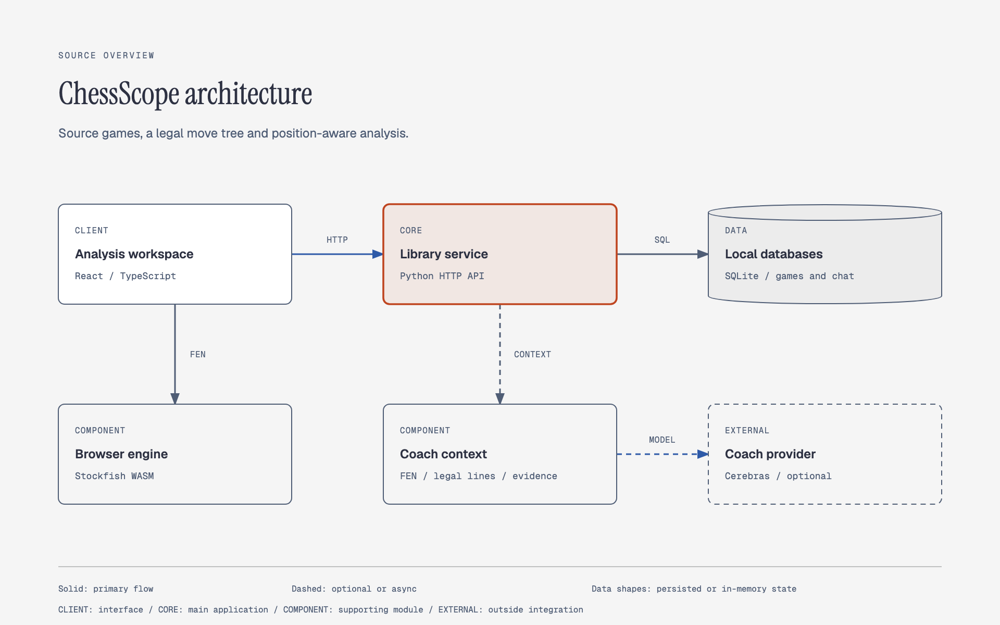

# ChessScope

A chess research workspace for finding an opponent's games, analysing a position and saving preparation lines.

The board keeps the source PGN, legal move tree, Stockfish analysis and coach conversation together. A player can inspect the game behind an explanation and choose whether to add a suggested line.

Built for HACK_002 Vienna.


The coach text in this showcase is labelled illustrative demo copy. Live replies require a configured provider. The board, PGN tree and browser engine are application features.

## From opponent to preparation

Search the local game library, open a player record and choose a source game. Selecting a move updates the board and engine position. Preparation keeps the chosen player, colour, opening, goal and coach conversation together.

The captured library index contains roughly 1.2 million records. It is a local sample with reported exclusions, not a complete official history of every player.


## How it works



[Vector diagram](docs/diagrams/architecture.svg) · [Editable HTML](docs/diagrams/architecture.html)

The Python service serves the library and preparation API. SQLite holds game evidence and separate coach history. `chess.js` and `python-chess` check move legality; Stockfish evaluates the selected position in the browser.

The coach receives a checked FEN, legal lines and bounded game evidence. Each turn retains a context snapshot. Suggestions enter the move tree only after the user chooses to apply them.

## Run locally

The library needs local `data/corpus.sqlite` and `data/library.sqlite` files. They are not bundled with this source checkout. See the [ingestion guide](docs/09-database-parsing.md) and [library guide](docs/10-game-library.md) to prepare them.

```bash
python3 -m venv .venv
.venv/bin/pip install -r requirements-ingestion.txt
cd frontend && npm ci && npm run build && cd ..
.venv/bin/python -m library serve --corpus data/corpus.sqlite --library data/library.sqlite --port 8765
```

Open http://localhost:8765. For live coach replies, configure `CEREBRAS_API_KEY` in the environment or ignored `.env.local`; `CEREBRAS_MODEL` is optional.

## Stack

React · TypeScript · Vite · chess.js · Stockfish WASM · Python · python-chess · SQLite · Cerebras

[Complete product tour](DEVELOPMENT.md) · [Coach architecture](docs/12-ai-coach-architecture.md) · [Preparation design](docs/13-preparation-redesign-plan.md)

## Sources and license

The bundled board study comes from [Lichess](https://lichess.org/study/RoBvWqfx/0IsLRqJa). Player and ratings views retain their source attribution. The [MIT license](LICENSE) covers this repository's code; source datasets retain their own terms.
